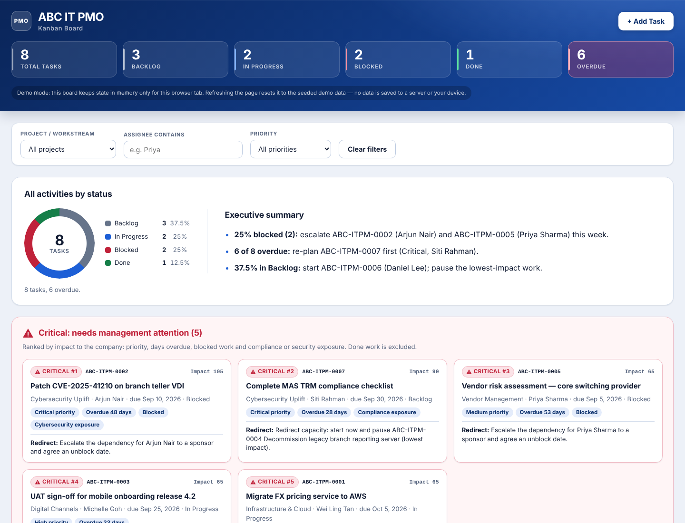

# ABC IT PMO — Kanban Board

A single-file Kanban board for a fictional bank's internal IT PMO. It is a demo and training tool, not tied to any real bank system or branding.

## Features

- Four columns: Backlog, In Progress, Blocked, Done, each with a live count
- Drag and drop cards between columns, or use the "Move ▸" control on each card
- Priority colour coding, overdue badges and an inline delete confirmation
- Add Task form with inline validation
- Filters by project, assignee and priority, plus a live summary strip

## Run locally

Open `index.html` in a browser. There is no build step, server or dependency.

## Notifications

Adding a task sends an email notification through [FormSubmit](https://formsubmit.co). Change `FORMSUBMIT_ENDPOINT` near the top of the script in `index.html` to your own address. The first submission to a new address triggers a confirmation email, and nothing is delivered until you click the link in it. If the request fails, the card stays on the board and a warning toast appears.

## Demo mode

Board data lives only in memory. Refreshing the page resets it to the seeded demo tasks.
